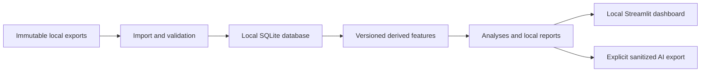

# Personal Health Analytics

A Windows-first, local-first project for exploring associations between PsychonautWiki Journal records, Samsung Health wellness data, Strava activities, and HabitShare habits. The longer-term vision is a personal experience app connecting health, books, films, games, live music, and planning.

## Current status

This repository contains planning documents and a small legacy journal-analysis prototype. The normalized database, import pipeline, `health` CLI, and dashboard are **planned, not implemented**. A journal export was inspected locally; Samsung Health, Strava, and HabitShare adapters await representative exports.

- [Source audit](docs/SOURCE_AUDIT.md): verified schema observations and missing evidence.
- [Proposed data model](docs/PROPOSED_DATA_MODEL.md): SQLite entities, provenance, identity, and time handling.
- [Implementation plan](docs/IMPLEMENTATION_PLAN.md): milestones and acceptance criteria.
- [Personal experience vision](docs/PERSONAL_EXPERIENCE_VISION.md): broader integrations and solution engineering portfolio examples.

## Planned architecture



Python handles ingestion and analysis. GitHub hosts source and documentation; personal analysis runs on your machine. Samsung Health exports are the initial wellness source. Strava begins with bulk exports; HabitShare needs export verification or a manual CSV fallback. Android Health Connect is an optional later export bridge.

## Privacy and interpretation

- No telemetry, automatic cloud upload, or subscription requirement is planned.
- Raw exports, databases, generated reports, personal mappings, credentials, backups, and detailed audits are ignored by Git.
- Public audits disclose schema only, excluding personal counts, dates, findings, and mappings.
- Review every staged file; ignore rules do not prevent forced additions. Public fixtures must be synthetic.
- Keep backups outside Git, preferably encrypted, and test restoration of raw sources, database, and configuration.
- AI context exports require deliberate selection and review; omit journal prose, names, and locations by default.

Missing records do not mean zero activity or abstinence. Analyses describe associations with sample sizes, uncertainty, and confounders; they do not establish causation, diagnose conditions, or recommend substance doses.

## Legacy prototype

`analyze.py` reads a Journal v15-style JSON export and produces local aggregates for custom products named Adderall XR and Adderall IR. It uses exported component doses, excludes named other consumers, and retains unknown doses. It is not the planned general importer.

Requires Python 3.10+ and IANA timezone data (`tzdata` on Windows):

```powershell
python -m pip install tzdata
New-Item -ItemType Directory -Force private
python analyze.py path/to/export.json --output private/summary.json
python -m unittest test_analysis
```

`comparison.html` requires `__JOURNAL_DATA__` replacement and host styling. It is a template, not a standalone dashboard. Generated copies containing personal data belong in `private/`.

## Future workflow

After implementation, drop recurring exports into a local inbox, run `health sync`, review `health doctor`, and generate reports. These commands do not exist yet. Adding a metric requires an inspected sample, documented units and mappings, provenance, synthetic fixtures, and missing-data tests.
